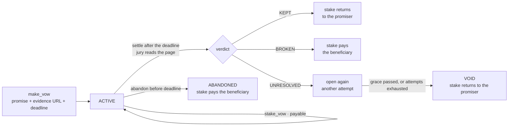

# Vow

**Money behind your word, settled by a committee that reads the web.**

A Vow is a promise you publish on-chain together with the page that will prove
it — and, if you mean it, a stake of GEN that you forfeit when that page says you
did not keep your word. Once the deadline passes, anybody may settle the vow: the
committee fetches the page, judges the promise against it, and must quote the
exact sentence that decided the case.

No counterparty. No trusted judge. No oracle, no escrow agent, no arbitration
service. The adversary you are posting against is yourself.

<div align="center">

<p>
  <a href="https://github.com/weels007/genlayer-vow/actions/workflows/ci.yml"></a>
  <a href="https://github.com/weels007/genlayer-vow"></a>
</p>

<p>
  
  
  
</p>

</div>

---

## Live on GenLayer Studio

`deployment.json` is the single source of truth for the deployed address: the
**Deploy Contract** workflow deploys once, writes it, and commits it back to
`main`. Until that file exists, nothing is deployed.

The Studio suite deploys its own copy of the contract, so its twenty-odd live
transactions never touch the published one. **Wallet Smoke** is the run that
drives the address in `deployment.json`: one vow published, staked and abandoned,
with every hash printed. That is also how the wall gets its first entry.

| | |
|---|---|
| **Network** | GenLayer Studio — chainId `61999` (`0xf22f`), test GEN only |
| **Deployer** | `scripts/deploy.py`, run by the **Deploy Contract** workflow with the tester1 wallet |
| **Evidence** | [Actions](https://github.com/weels007/genlayer-vow/actions) — the direct suite, the Studio suite, and every deployment |

## The idea

Every accountability product today needs somebody to be believed: a platform
that checks, a notary that attests, a court that rules. That is the whole cost of
a promise — and it is the reason most promises are worth nothing.

GenLayer is the first chain where a committee can read an arbitrary public page,
judge whether natural-language promise was kept, and agree on the answer before
anything moves. So the promise itself can be the contract:

- **You write it.** A falsifiable sentence ("ship v1.0 to production", "publish
  the audit by 1 May", "run 100km this month") and the page that will show it.
- **You freeze it.** The promise, the evidence URL and the deadline are locked at
  creation. You cannot move the goalposts afterwards, and neither can anyone else.
- **You stake it.** GEN behind the word, held by the contract, returned in full if
  the page proves you kept it.
- **A stranger settles it.** After the deadline anybody may call `settle`. The
  committee fetches the page, returns `KEPT` / `BROKEN` / `UNRESOLVED` with a
  verbatim quote, and the stake moves with the verdict.
- **The record stays.** A public, O(1) kept-rate per address, with a title derived
  from the counters — the beginning of a credit signal that does not depend on
  anybody's opinion of you.

A vow is *not* a prediction market and *not* an escrow for work: there is no bet
against an outcome and no counterparty who must be identified. It is a
commitment device, and the only thing the contract needs from the world is one
page and an honest reading of it.

## Lifecycle



Statuses: `ACTIVE`, `KEPT`, `BROKEN`, `ABANDONED`, `VOID`.
The jury's verdict is one of `KEPT`, `BROKEN`, `UNRESOLVED`; an abandoned vow
records `ABANDONED` as its verdict so an honest early exit is never confused
with a verdict the committee reached.

## How a verdict is produced

| Step | What happens |
|---|---|
| **Fetch** | The frozen evidence URL is rendered as text inside a non-deterministic block, capped at `MAX_EVIDENCE_CHARS`. |
| **Judge** | The model returns `verdict`, a verbatim `quote`, and a short `reason`. The promise, the criteria and the page are framed as untrusted data. |
| **Ground** | `quote` must be a substring of the fetched page after folding to letters and digits. A quote that is not on the page cannot settle anything. |
| **Consensus** | Validators re-run the fetch-and-judge step and must match on `verdict` exactly. Disagreement writes nothing. |
| **Store** | On agreement: the verdict, the grounded quote, the reason, the evidence digest and the attempt counter. The money moves only after that. |

Only the **verdict** is compared. An integer score or a paragraph of reasoning is
exactly what two independent models disagree on; a three-valued decision is what
they agree on. The quote is descriptive and never compared, so two careful readers
may cite different sentences of the same page and still consent.

### Error taxonomy

| Tag | Meaning | Consensus behaviour |
|---|---|---|
| `[EXPECTED]` | bad input, wrong caller, not due, already closed | deterministic, must match |
| `[EXTERNAL]` | the evidence page is empty | deterministic, recorded |
| `[TRANSIENT]` | network / 5xx | both transient means agreement, retry |
| `[LLM_ERROR]` | malformed or ungrounded model output | always disagrees → new leader |

Errors are compared by tag and first code segment, not by full message text, so
two nodes reporting the same deterministic failure agree instead of deadlocking.

## Money rules

Value enters through exactly one call, `stake_vow`, and it is payable so it can
never revert once the GEN is attached. A refused target becomes a **credit**
recorded against the sender and withdrawable with `withdraw_credit` — a payable
call must never strand value.

- **Only the promiser stakes.** The same stake returns on `KEPT`, so a stranger
  paying into somebody else's vow would create a payout it could not claim.
- **`KEPT` returns the stake in full.** Keeping your word is free; that is the
  point.
- **`BROKEN` pays the beneficiary**, minus a small **settler bounty** (2 %, and
  only for stakes of at least `MIN_BOUNTY_STAKE`) when the caller is neither the
  promiser nor the beneficiary. Settling is public work and should pay for itself.
- **`ABANDONED` pays the beneficiary immediately**, with no bounty: nobody
  settled anything, the promiser simply stopped pretending.
- **`UNRESOLVED` moves nothing.** A page that is gone, empty or silent never
  confiscates a stake. The vow stays open, and after the grace window — or once
  the attempt cap is reached — anybody may `void_vow`, which refunds the promiser.
- **The ledger is updated first and the transfer last**, so a failed transfer
  rolls both back together. Before paying out, the contract checks both the
  ledger and the real balance.

Invariant: `total_in == total_out + locked_total`, credits included.

## Contract API

**Write**

| Method | Who | Purpose |
|---|---|---|
| `make_vow(promise, evidence_url, criteria, deadline_seconds, beneficiary, vow_ref)` | anyone | publish a promise; freezes text, source and deadline (60 s … 365 d) |
| `stake_vow(vow_id)` · payable | the promiser | add GEN behind the word; never reverts once value is attached |
| `withdraw_credit()` | anyone with a credit | take back money that arrived for a refused stake |
| `settle(vow_id)` | anyone, after the deadline | ask the committee; moves the stake with the verdict |
| `abandon(vow_id)` | the promiser, before the deadline | forfeit now and say so |
| `void_vow(vow_id)` | anyone | refund an unresolvable vow after the grace window or the attempt cap |
| `set_paused(paused)` | owner | stop new vows and new stakes; settlement is never paused |
| `transfer_ownership(new_owner)` · `accept_ownership()` | owner, then nominee | two-step handover |

**View**

| Method | Returns |
|---|---|
| `get_vow(id)` · `get_vows()` · `get_vow_ids()` | the wall of vows |
| `get_standing(address)` | kept / broken / abandoned, kept-rate in bps, standing title, staked, returned, credit |
| `get_ledger()` · `get_balance()` | `total_in`, `total_out`, `locked_total`, real balance |
| `get_summary()` | O(1) counters: vows, active, kept, broken, abandoned, void |
| `is_due(id)` · `get_rules()` | whether the deadline passed, and the bounds this contract enforces |
| `get_owner()` · `get_pending_owner()` · `is_paused()` | governance |

## Security properties

- **No confiscation without a verdict** — the only paths that move a stake are a
  grounded verdict, the promiser's own abandon, or a void that refunds the
  promiser. Being silent is never punished.
- **Grounded reasoning** — `quote` must be a substring of the fetched page after
  folding to letters and digits, so formatting cannot fake or break a citation.
- **Frozen evidence** — promise, URL and deadline are immutable once written; a
  vow cannot be re-aimed at a friendlier page.
- **Untrusted text** — caller text is normalised, length-capped and stripped of
  angle brackets, and framed in the prompt as facts that must never be read as
  instructions.
- **No SSRF probe** — `https` only, a real hostname, no IP literal, `localhost`,
  `*.local`, `*.internal` or cloud metadata names. Without this the committee
  would be a request-forgery proxy for whoever picks the URL.
- **No double post** — caller-scoped `vow_ref`; a replay reverts with
  `[EXPECTED]:duplicate_vow_ref` instead of minting a second vow.
- **Bounded work** — 5 000 vows, 20 active per promiser, capped strings, at most
  five settlement attempts per vow, O(1) counters.
- **Two-step ownership** — nominate, then the nominee accepts.

Known limits, stated plainly:

- A promiser chooses the evidence page, so a reputation is only as good as the
  pages they chose. Every vow keeps its URL and quote public so a reader can judge
  the source themselves.
- This is a commitment device, not a court. It settles whether a written promise
  was kept against a named page; it does not interpret law, and it should not be
  used as legal or compliance advice.
- `reason` is descriptive and never fed back into a decision.
- Direct-mode tests do not execute external transfers, so the Studio suite is what
  exercises the payout paths end to end (`abandon` and `withdraw_credit` pay out,
  and a resolved `settle` moves the stake).

## Built from the GenLayer docs

The [build ideas](https://docs.genlayer.com/developers/intelligent-contracts/ideas)
list — prediction markets, AI arbitration, parametric insurance, bounties, AI
notary, retroactive funding — all lean on the same primitive: *judge a claim
against evidence*. Vow takes that primitive somewhere the list does not go, to a
commitment with **no counterparty and no dispute**: the claim is about the
promiser's own conduct, the evidence is a page they named in advance, and the
money at risk is theirs alone.

The contract follows the pattern the docs recommend for a robust Intelligent
Contract: fix the question, the evidence and the deadline at creation; retrieve
the evidence inside a non-deterministic block; return a small structured result;
have validators re-derive it and compare the decision field; then apply the
accepted result through deterministic state changes.

## Quick start

```bash
pip install -r requirements.txt

genvm-lint check contracts/Vow.py   # forbidden imports, storage, nondet misuse
pytest tests/direct -v              # the whole suite, in memory, milliseconds
pytest tests/integration -v -s      # one deploy, every method, live consensus

python scripts/deploy.py            # deploy once, record deployment.json
```

The direct suite runs without a network: the web page and the model are mocked,
and `direct_vm.warp()` moves the clock past the deadline.

The Studio suite needs the two test wallets. Locally, drop `tester1-keystore.json`
+ `tester1.password` and the `tester2` pair into `tests/` (never tracked). In CI it
reads them from four repository secrets instead:

| Secret | Value |
|---|---|
| `VOW_TESTER1_KEYSTORE` | `tester1-keystore.json`, raw JSON or base64 |
| `VOW_TESTER1_PASSWORD` | the keystore password |
| `VOW_TESTER2_KEYSTORE` | `tester2-keystore.json`, raw JSON or base64 |
| `VOW_TESTER2_PASSWORD` | the keystore password |

The same pair covers the deploy workflow: tester1 signs and owns the contract,
tester2 is the beneficiary and the stranger in the adversarial checks.

## Status

- **Direct suite** — `pytest tests/direct`, no network, runs in CI on every push.
- **Studio suite** — `pytest tests/integration`, deploys once and drives every
  public method on studionet: the registry guards, the stakes and credits, the real
  payouts, `settle` against a live page with a live committee, the governor, and
  the refusals that matter.
- **Deploy** — **Deploy Contract** deploys once and commits `deployment.json`; a
  push that does not change the contract reuses the recorded address.

What is not built yet is the console: a wall of vows with a stake button and a
settle button, reading `get_vows()` and `get_standing()`.

## Layout

```text
contracts/Vow.py                 the Intelligent Contract
tests/direct/                    creation, settlement, consensus, money, views
tests/integration/               the studionet suite: every method, live
scripts/deploy.py                deploys once, records deployment.json
scripts/wallet.py                keystores from tests/ or from VOW_* secrets
deployment.json                  the deployed address (written by the workflow)
.github/workflows/ci.yml         genvm-lint + the direct suite
.github/workflows/integration.yml  the studionet suite
.github/workflows/deploy-contract.yml  one deploy, address committed back
gltest.config.yaml               Studio / localnet targets for gltest runs
```

## License

[MIT](LICENSE).
